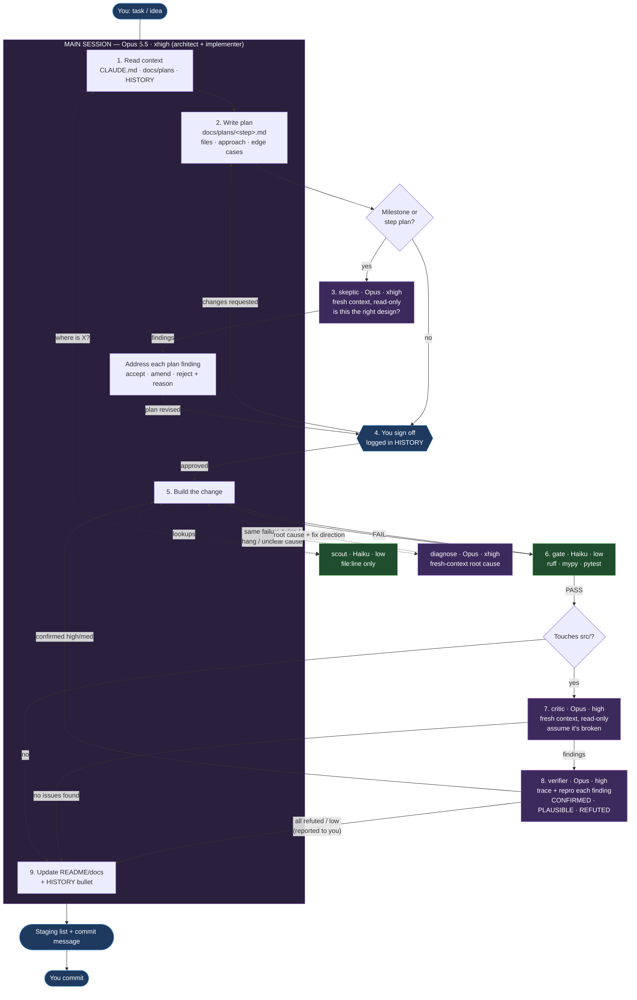

# Vestibule — workflow diagram

Visual companion to [`WORKFLOW.md`](WORKFLOW.md). Box colors: purple = Opus, green = Haiku,
blue = you (Victor).

## Flowchart (renders on GitHub / VS Code preview)



## Plain-text version (for the terminal)

```
                         you: task / idea
                                │
                                ▼
 ┌──────────────── MAIN SESSION · Opus 5.5 ────────────────┐      ┌──────────────────┐
 │  1. read context (CLAUDE.md, plans, HISTORY) ◄───────────┼─────►│ scout · Haiku    │
 │                     │                                    │      │ file:line only   │
 │                     ▼                                    │      └──────────────────┘
 │  2. write plan → docs/plans/<step>.md                    │
 └─────────────────────┬────────────────────────────────────┘
                       ▼
        milestone/step plan? ──yes──► 3. skeptic · Opus (read-only)
                       │                     │ findings
                       │                     ▼
                       │          main session: accept / amend / reject + reason
                       no                    │
                       ▼                     ▼
        4. YOU SIGN OFF (logged in HISTORY) ◄┘
                       │  changes requested → back to 2
                       ▼
 ┌──────────────── MAIN SESSION · Opus 5.5 ────────────────┐
 │  5. build the change ◄───────────────────────────────┐   │ ◄─ stuck? ─► diagnose · Opus
 └─────────────────────┬────────────────────────────────┼───┘            (root cause only)
                       ▼                                │
        6. gate · Haiku: ruff · mypy · pytest ──FAIL────┤
                       │ PASS                           │
                       ▼                                │
        touches src/? ──no──────────────────┐           │
                       │ yes                │           │
                       ▼                    │           │
        7. critic · Opus (read-only)        │           │
                       │ findings           │           │
                       ▼                    │           │
        8. verifier · Opus ─CONFIRMED high/med──────────┘
                       │ refuted / low      │
                       ▼                    ▼
        9. README/docs + HISTORY bullet ◄───┘
                       │
                       ▼
        staging list + commit message  ──►  YOU COMMIT
```

## Who runs on what

```
 Opus 5.5   ██████  main session (plan + build), skeptic, critic, verifier, diagnose
 Haiku 5.5  ██      scout, gate                         ← mechanical, cheap
 You        ██      plan sign-off, final say on rejected findings, git commit
```

## Effort per role

```
 xhigh  ████████  main session · skeptic · diagnose   ← design + root cause: wrong = expensive
 high   ██████    critic · verifier                    ← find + prove defects in a bounded diff
 low    ██        scout · gate                         ← search + run commands, no judgment
```

## Finding → action

| Source | Verdict | Action |
|---|---|---|
| skeptic (plan) | design argument | main session accepts, amends, or rejects with a reason, before your sign-off |
| critic (diff) | CONFIRMED high/med | fix, then repeat from step 6 (re-run critic if the fix spread) |
| critic (diff) | PLAUSIBLE | fix, or explain to you why not |
| critic (diff) | REFUTED / low | listed in the summary to you, no code change |

## Loop exits at a glance

| Loop | Goes back to | Trigger |
|---|---|---|
| Plan loop | step 2 | skeptic findings accepted, or you ask for changes |
| Build loop | step 5 | gate FAIL, or a CONFIRMED high/med finding |
| Escape hatch | diagnose → step 5 | same failure twice, a hang, or an unclear root cause |
